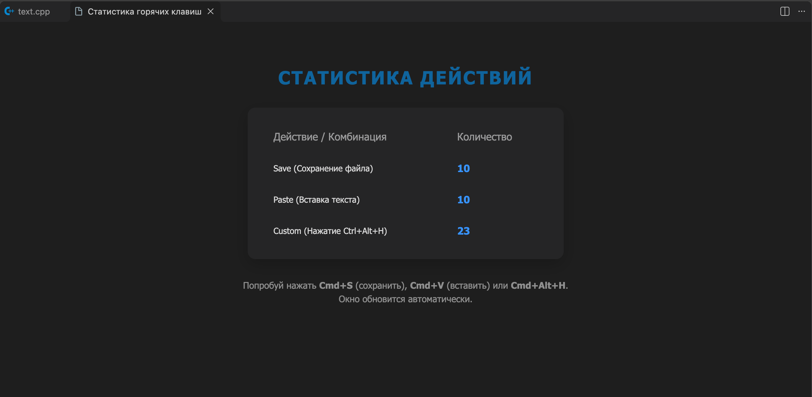

# Hotkey Counter

**Автор:** Петров Вячеслав, группа М3114

## Описание
Расширение для Visual Studio Code, которое ведет подсчет нажатий горячих клавиш и системных действий (сохранение, вставка), а также отображает красивую статистику в отдельном окне (Webview Dashboard).

## Возможности
- Подсчет количества сохранений файла (Ctrl+S / Cmd+S).
- Подсчет количества вставок текста (Ctrl+V / Cmd+V).
- Подсчет вызовов собственной горячей клавиши (Ctrl+Alt+H / Cmd+Alt+H).
- Красивый интерактивный дашборд, который автоматически обновляется в реальном времени.
- Сохранение статистики между сессиями (даже после перезапуска VS Code).

## Как запустить
1. Откройте палитру команд (Ctrl+Shift+P / Cmd+Shift+P).
2. Введите `Hotkey Counter: Открыть статистику`.
3. Или нажмите горячую клавишу `Ctrl+Alt+H` (Windows/Linux) / `Cmd+Alt+H` (Mac).

## Демонстрация
