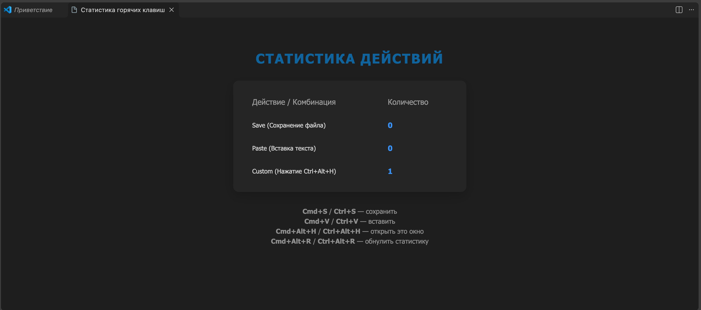

# Hotkey Counter (Счетчик горячих клавиш)

**Автор:** Петров Вячеслав, группа М3114

## Описание
**Hotkey Counter** — это расширение для Visual Studio Code, которое в реальном времени отслеживает и подсчитывает частоту использования определенных действий и горячих клавиш. Плагин сохраняет статистику в глобальное хранилище редактора (она не пропадает после перезапуска) и отображает её в виде дашборда.

Интерфейс дашборда автоматически подстраивается под текущую цветовую тему VS Code (светлую или темную).

## Возможности
Плагин умеет считать:
- **Сохранения файлов** (нажатия `Ctrl+S` / `Cmd+S`).
- **Вставки текста** (нажатия `Ctrl+V` / `Cmd+V`).
- **Вызовы собственного дашборда** (нажатия `Ctrl+Alt+H` / `Cmd+Alt+H`).

## Управление (Горячие клавиши)
- **`Ctrl+Alt+H`** (на Mac: `Cmd+Alt+H`) — открыть окно со статистикой (Дашборд).
- **`Ctrl+Alt+R`** (на Mac: `Cmd+Alt+R`) — полностью обнулить всю статистику.

*(Также все команды доступны через палитру команд `Ctrl+Shift+P` / `Cmd+Shift+P` по запросу "Hotkey Counter").*

## Как это работает (Архитектура)
Плагин использует современный **VS Code Extension API**:
1. **Webview API** — для создания красивого пользовательского интерфейса (дашборда) на базе HTML/CSS внутри редактора. Окно обновляется в реальном времени при изменении счетчиков.
2. **GlobalState API** — для надежного хранения статистики между сессиями.
3. **Слушатели событий (Event Listeners)** — плагин перехватывает `onDidSaveTextDocument` (сохранение) и `onDidChangeTextDocument` (вставка), чтобы безопасно считать действия пользователя, не блокируя стандартные горячие клавиши системы.

## Установка
1. Скачайте файл `hotkey-counter-0.0.1.vsix` из релизов (или соберите проект самостоятельно командой `vsce package`).
2. Откройте VS Code, перейдите во вкладку Расширения (`Ctrl+Shift+X`).
3. Нажмите на три точки `...` в правом верхнем углу панели и выберите **`Install from VSIX...`**.
4. Выберите скачанный файл.

## Демонстрация
